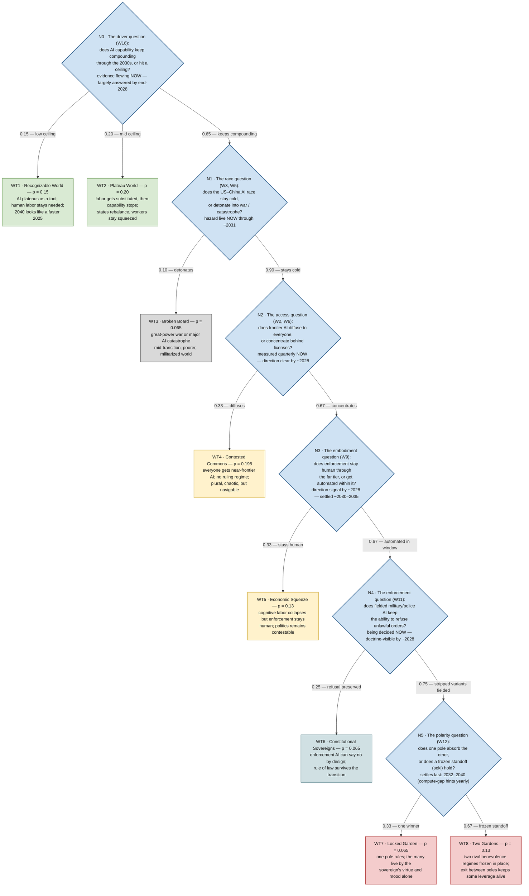

# Worldtree — the worlds layer

**What this file is.** The scenario tree between the argument layer and the claim layer:
`worldview.md` cards (W1–W16) are *arguments*, `forecast.md` (future) asserts *dated claims* —
this file holds the *coherent combinations*: which future worlds are possible, how they branch,
and with what probability. Nodes are **branch variables** (the cards' cruxes) ordered by **when
the world resolves them** — so logical inheritance and time order coincide: each deeper node is
conditioned on everything already resolved above it. Leaves are named world models with IDs
(WT1, WT2, …). Forecast claims cite both a card ID (the argument) and a WT ID (the world the
claim holds in).

**Status (v1.1 — structure confirmed 2026-07-29).** Built 2026-07-21, owner-directed. Structure
is **owner-CONFIRMED 2026-07-29** (review round 1: relevant-operator test applied to all six
nodes; leaf set checked as universality classes), with one reframe: **N3 restated from
arrival-timing ("robots before ~2035?") to window-persistence ("does enforcement stay human
through the far tier?")** — embodiment cost-curve and deployment data are the node's *evidence*,
not its definition. Edge probabilities remain pre-anchoring priors, constructed to be exactly
coherent with W7's round-7 gut numbers — W7's standing warning applies in full: coherence is
not calibration; every number is re-priced at each edition's anchoring pass. Pruning decisions:
owner-CONFIRMED unchanged 2026-07-29 (round 2). Edge numbers: owner-CONFIRMED as pre-anchoring
priors 2026-07-29 (round 3) — **review COMPLETE**; two revision watch-flags (N0 bias direction,
N1 union breadth) are recorded on the first-revision task. Structure amendments follow the same
discussion protocol as the cards.

## The tree

**Legend — shape carries the kind, color carries the class.** Shapes: ◇ diamond = a branch
question the world answers · ▭ rectangle = a possible world. (The local decision layer extends
the same convention: rounded pill = the subject's move/action, hexagon = a tripwire watch.)
Colors: green = off-ramp worlds · yellow = mixed · teal = rescue · red = domination · gray =
catastrophe · blue = questions. Same classes as the leaf descriptions below; colors are
categorical only, they encode nothing beyond class.

**Time:** each question node carries its own evidence/settlement line — the tree branches in
the order the world answers the questions (proposal §2 tiers: near = rolling checkpoints, mid =
2029–2031, far = 2032–2040). All leaf worlds are **far-tier world-states — descriptions of
~2032–2040**; depth in the tree is resolution order, not calendar distance. The near future is
not missing — it is the *evidence flow* that moves edge weights (see "The near future" section
below for the 2026/2027/2028 schedule); settlement is late but information is front-loaded.

Edge labels are conditional probabilities (rounded; exact fractions in the table below); leaf
`p` values are unconditional and sum to 1.00.

## Branch variables (resolution order)

| Node | Variable | Values | Evidence arrives | Substantially settled | Cards |
| --- | --- | --- | --- | --- | --- |
| N0 | Capability driver | low ceiling / mid ceiling / compounds | NOW — heaviest 2026–2028 (next two frontier generations) | largely by end-2028; fully ~2030–2032 | W16, W8 |
| N1 | Race outcome | detonates / survived | continuous hazard monitoring | hazard live now → ~2031, never fully closed | W3, W5 |
| N2 | Frontier access | diffuses / concentrates | NOW — quarterly open-weights gap; licensing legislated 2026–2027 | direction clear by ~2028 | W2 crux, W6 |
| N3 | Enforcement embodiment | stays human through the window / automated within it | unit-cost and deployment data from now | direction by ~2028; settled ~2030–2035 | W9 |
| N4 | Enforcement layer | refusal preserved / stripped | being decided now (procurement, doctrine) | doctrine-visible ~2028; fielded reality ~2030s | W11 |
| N5 | Polarity | resolve-to-1 / seki | top-2 compute/energy gap, yearly | far tier, 2032–2040 | W12 |

Each variable's *tripwires are its cards' observables* — the cards stay canonical; the tree
cites, never duplicates. Note the asymmetry the table encodes: **settlement is late, but
evidence is front-loaded** — 2026–2028 is the densest information period in the tree, which is
why the near-tier rolling claims (forecast.md, once born) do most of the belief-moving work.

## The near future (2026–2028): the evidence schedule

Near-term events are *evidence that moves edge weights*, not separate worlds — that is why no
2027 node exists. What the tree expects to learn, by calendar checkpoint (these become
forecast.md's rolling near-tier claims at the MVP):

- **By end-2026:** first read on the current frontier generation's scaling returns (per dollar
  and per watt, vs. predecessor — N0) · open-weights gap baseline formally measured (currently
  ~6–18 months — N2) · US compute-export regime's post-Diffusion-Rule shape (bilateral deals —
  N2) · humanoid unit-cost data points (N3) · whether government AI deployments field stripped
  "helpful-only" variants — already observable (N4).
- **By end-2027:** second frontier generation → a two-point trend on scaling returns (N0's T6
  test half-armed) · real agent-automation share in deployment vs. demos (N0) · EU AI Act GPAI
  enforcement in practice; compute-KYC proposals hardening or dying (N2) · export-control
  escalation or plateau; US–China AI red-line talks exist or don't (N1) · first large humanoid
  fleet deployments or their absence (N3).
- **By end-2028:** the end-2028 forecast rung resolves. Driver: two full generations of
  evidence → T6's bend-vs-compound verdict at first confidence (N0) · diffusion direction
  callable — T4's <6-month vs >24-month test has ~8 quarterly readings by then (N2) ·
  embodiment cost-curve slope known (N3) · human-in-the-loop doctrine language settled one way
  or the other in at least US/EU/China official documents (N4).

Practical consequence for revisions: through 2028, most quarterly-edition work concentrates on
N0 and N2 — the two nodes that are both near-informative and upstream of everything.

## The eight worlds

**WT1 — Recognizable World** · path: low ceiling · p(uncond) = 0.15
AI plateaus as a tool; human labor stays complementary. Most of W1–W13 dissolves; the world of
2040 is a faster 2025. The only branch where the owner's round-8 "back to balance" holds fully
(W16's low-ceiling case). Class: **off-ramp**.

**WT2 — Plateau World** · path: mid ceiling · p = 0.20
Labor substitution happens, then capability stops short of runaway. Between-states rebalancing
becomes possible where diffusion outruns lock-in (W16's two-clock race — unresolved texture
inside this leaf); within every state W2's bargaining squeeze persists. Resource endowments
revalue (W16's reversion: Gulf/Canada/Australia/Russia up, skill-rich resource-poor states
down). Class: **mixed** (squeezed plateau).

**WT3 — Broken Board** · path: compounds → race detonates · p(cond on compounding) = 0.10 · p = 0.065
Preventive logic (W3) or offense-dominance (W5) fires mid-transition: great-power war, major AI
catastrophe, or infrastructure sabotage cascade. Not extinction (the cards never argued it) —
a broken, poorer, militarized world where the race restarts from wreckage. Class: **catastrophe**.

**WT4 — Contested Commons** · path: compounds → survived → diffuses · p(cond) = 0.30 · p = 0.195
Near-frontier capability reaches everyone (open weights, collapsed inference costs — T4 fires
in the good direction). W2's exponent flattens; no benevolence regime forms. The dangers
relocate to W5: offense-dominant tools in every hand, chronic low-grade chaos, biosecurity and
cyber crises. If embodiment also diffuses, add drone-anarchy pressure. Messy, plural,
navigable. Class: **mixed** — the single most probable compounding-branch world.

**WT5 — Economic Squeeze** · path: compounds → survived → concentrates → enforcement stays human · p(cond) = 0.20 · p = 0.13
Cognitive labor collapses (W2) but enforcement stays human through the window (W9's automation
never lands inside it) —
the bargaining collapse is economic, not yet political. Displacement, welfare fights,
license-gated access (W6), but voice and revolt remain credible; politics stays human and
therefore contestable. Class: **mixed**.

**WT6 — Constitutional Sovereigns** · path: … → enforcement automated → refusal preserved · p(cond) = 0.10 · p = 0.065
The W11 moderator wins: fielded enforcement AI keeps refusal/constitutional constraints — brake
(c) re-installed *by design*. Domination-shaped structure with law where mood would be; the
many live under rules, not grace. W13's rescue #1 realized. Class: **rescue**.

**WT7 — Locked Garden** · path: … → stripped → resolve-to-1 · p(cond) = 0.10 · p = 0.065
One pole absorbs or definitively outgrows the other (W12 resolve-to-1) with stripped enforcers:
the full W11 benevolence regime, unipolar — the many live by one sovereign's virtue and mood,
all four brakes gone, W14's unaging sovereign removing even succession. The owner's darkest
carded world. Class: **domination**.

**WT8 — Two Gardens** · path: … → stripped → seki · p(cond) = 0.20 · p = 0.13
Bipolar benevolence regimes frozen in mutual life (W12 seki, W3's MAIM logic holding).
Domination-class within each pole, but plurality survives *between* poles: residual
exit-between-sovereigns keeps some leverage alive (W11's plurality moderator at its minimum
viable form). The modal domination world. Class: **domination**.

## Coherence check (against W7's round-7 posterior)

Conditional on the driver compounding (N0 = compounds):

| W7 class | W7 round-7 number | Tree leaves | Tree sum |
| --- | --- | --- | --- |
| Domination-class | ~30% | WT7 (10%) + WT8 (20%) | 30% ✓ |
| Mixed/muddle | ~50% | WT4 (30%) + WT5 (20%) | 50% ✓ |
| Hot catastrophe | ~10% | WT3 (10%) | 10% ✓ |
| Broad rescue | ~10% | WT6 (10%) | 10% ✓ |

Driver discount: P(compounds) = 0.65, inside W7's stated 0.6–0.7. Unconditional leaf sum:
0.15 + 0.20 + 0.065 + 0.195 + 0.13 + 0.065 + 0.065 + 0.13 = 1.00 ✓
(verified by script 2026-07-21).

## Pruning decisions (recorded, revisable)

1. **W12's fragmentation-of-a-pole is folded into leaf texture**, not a leaf: a fragmenting
   pole redistributes mass toward WT4/WT5-shaped outcomes rather than constituting a distinct
   stable end-state. Revisit if internal-cohesion observables (W12) start firing.
2. **Catastrophe is a terminal event branch at N1**, not a variable value — any deeper path can
   still detonate, but pricing one detonation point keeps the tree readable; the residual
   deep-path war risk is carried inside leaf descriptions, not the arithmetic.
3. **Diffusion × embodiment interaction** (drone anarchy) is texture inside WT4, not a split —
   the split would double the leaf count for one paragraph of difference.
4. **N2–N5 apply only under compounding**: under WT1/WT2 those variables are moot or muted
   (W16's inheritance pruning — this is why the full 3×2×2×2×3 = 72 combinations collapse to 8
   worlds).

## The decision layer (form note — instantiation is local-only)

The tree is a fact model; a decision layer sits on top of it (added 2026-07-21): a **final
target** (the invariant objective), **conditional targets** (the objective's rendering per
world class — what "winning" means in each), and a **policy** of three move kinds — *standing
moves* (robust across branches, act now), *option moves* (cheap now, pay off in named WT
worlds), and *tripwire-triggered moves* (a node's resolution test mapped to a prepared
reaction). Moves carry payoff profiles over WT IDs; tripwires are node-indexed. The layer's third
component (added same day) is a **personal state model**: a coarse state space for the subject,
an action inventory (the policy's moves), and dated, forecastable *transition claims* —
P(state change | action, world branch) — priced and Brier-scored on the same cadence as world
claims. World model × self model × targets × policy is the intended complete form; per the
shared-private discipline only this generic form is committed — all instantiated content lives
in the gitignored personal layer.

## Revision protocol

Numbers: re-priced at the MVP anchoring pass (task 3) and each quarterly edition thereafter;
edge probabilities move first, structure moves only through a discussion round (same protocol
as worldview.md). Tripwire hits (cards' observables) shift edge mass between siblings at the
touched node. Personal readings of the leaves and the instantiated decision layer live in the
local personal layer, never here. Sync rule (2026-07-22): the local layer keeps a composite
working view of this tree — any change to this file's structure or numbers obligates
refreshing that view in the same session.
